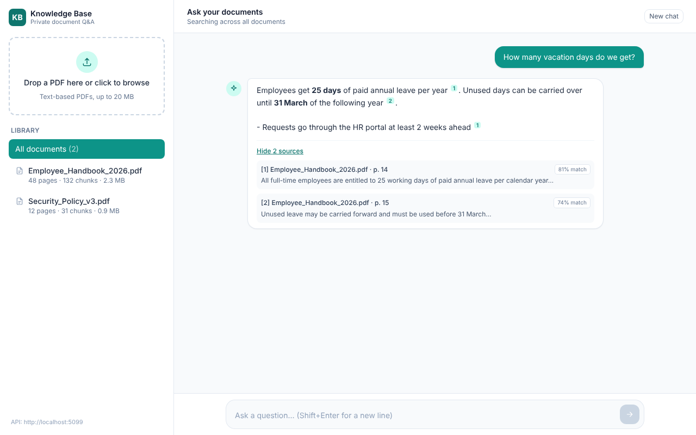

# Corporate AI Knowledge Base (RAG MVP)

Upload PDFs, ask questions, get answers grounded in your documents with page-level sources.

**Stack:** .NET 10 Web API · PostgreSQL 16 + pgvector (HNSW, cosine) · Dapper · OpenAI `text-embedding-3-small` + `gpt-4o-mini` · React 19 + Vite + TailwindCSS 4



## How it works

```
Upload:  PDF ─► PdfPig text (per page) ─► normalize ─► chunk 1000 / overlap 200
              ─► OpenAI embeddings (batched) ─► COPY into document_chunks (vector(1536))

Chat:    question (+ previous user turn) ─► embedding ─► top-K by cosine (<=>, HNSW)
              ─► gpt-4o-mini with numbered excerpts ─► answer with [n] citations + sources
```

- **Chunking** (`Services/TextChunker.cs`): sliding window that cuts on the strongest boundary in the second half of the window (paragraph → line → sentence → word), never starts mid-word, joins hyphenated line breaks, and tags each chunk with its starting page.
- **Vector search** (`Data/DocumentRepository.cs`): `ORDER BY embedding <=> @q` hits the HNSW index; similarity = `1 - distance`; a threshold (`Rag:MinSimilarity`) drops weak matches; optional per-document filter.
- **Safety:** PDF magic-byte check, size limits, SHA-256 dedupe, per-IP rate limiting, optional `X-Api-Key` gate, ProblemDetails errors with no internals leaked, prompt that treats excerpts as untrusted data.

## API

| Method | Path | Body | Returns |
|---|---|---|---|
| POST | `/api/documents/upload` | multipart `file` (PDF) | `{ documentId, fileName, pageCount, chunkCount, elapsedMs }` |
| POST | `/api/documents/chat` | `{ message, documentId?, history?: [{role, content}] }` | `{ answer, sources[], promptTokens, completionTokens }` |
| GET | `/api/documents` | – | document list |
| DELETE | `/api/documents/{id}` | – | 204 (chunks cascade) |
| GET | `/health` | – | DB status |

## Run locally

Prerequisites: Docker, .NET 10 SDK, Node 20+, an OpenAI API key.

```bash
# 1. Database
docker compose up -d postgres

# 2. Backend (http://localhost:5080)
cd backend/RagKb.Api
dotnet user-secrets set "OpenAI:ApiKey" "sk-..."
dotnet run

# 3. Frontend (http://localhost:5173)
cd ../../frontend
cp .env.example .env.local
npm install
npm run dev
```

Everything in Docker instead: `cp .env.example .env`, fill `OPENAI_API_KEY`, then `docker compose --profile full up --build` and open http://localhost:5080 (UI + API).

Smoke test without the UI:

```bash
curl -F "file=@./some.pdf" http://localhost:5080/api/documents/upload
curl -H "Content-Type: application/json" -d '{"message":"What is this document about?"}' \
     http://localhost:5080/api/documents/chat
```

Tests: `cd backend && dotnet test`

## Configuration

All settings live in `appsettings.json` and can be overridden with environment variables (`__` = nesting).

| Variable | Default | Notes |
|---|---|---|
| `OpenAI__ApiKey` | – | **required** |
| `DATABASE_URL` | – | `postgres://…` URL; wins over `ConnectionStrings__Postgres` |
| `ConnectionStrings__Postgres` | local docker | Npgsql key=value string |
| `Rag__ChunkSize` / `Rag__ChunkOverlap` | 1000 / 200 | overlap ≤ half of size |
| `Rag__TopK` / `Rag__MinSimilarity` | 5 / 0.25 | retrieval tuning |
| `Rag__MaxUploadSizeMb` | 20 | |
| `Security__AllowedOrigins__0..n` | `http://localhost:5173` | CORS; `https://*.vercel.app` allowed as a pattern |
| `Security__ApiKey` | empty (off) | when set, `/api/*` requires `X-Api-Key` |

> Changing `OpenAI__EmbeddingDimensions` after data exists requires dropping `document_chunks` (the column is `vector(1536)`).

## Push to GitHub

```bash
cd rag-kb
git init -b main
git add .
git commit -m "Initial commit: RAG knowledge base MVP"

# with GitHub CLI
gh repo create rag-knowledge-base --private --source=. --remote=origin --push

# or manually: create an empty repo on github.com, then
git remote add origin https://github.com/<you>/rag-knowledge-base.git
git push -u origin main
```

Before pushing, check that no secret is staged: `git grep -n "sk-" -- . ':!*.md'` should return nothing.

## Free live demo on Render (one URL, phone-friendly)

The root `Dockerfile` builds the React app and serves it from the API's `wwwroot`, so the whole demo is one service with no CORS setup. `render.yaml` also creates a free Postgres.

1. render.com → **New + → Blueprint** → connect GitHub → pick this repo → **Apply**.
2. When asked, paste your OpenAI key into `OpenAI__ApiKey`.
3. Wait for the first build (5–8 min: npm + dotnet restore + publish).
4. Open `https://ragkb-xxxx.onrender.com` on your phone. `/health` should say `healthy`.

Every push to `main` redeploys automatically. GitHub Actions (`.github/workflows/ci.yml`) builds, runs the tests, and builds the Docker image on every push.

### Free-tier caveats
- The web service sleeps after 15 min idle; the first request takes ~1 min to wake. Open `/health` before a demo.
- Render's free Postgres (1 GB) expires 30 days after creation. For a permanent demo, create a free Neon database and replace `DATABASE_URL` in the service's Environment tab with Neon's URL.
- The demo has no login. Rate limits (10 uploads / 10 min, 30 questions / min per IP) protect your OpenAI bill; also set a monthly spend limit in the OpenAI dashboard.

### Alternative: separate frontend on Vercel/Netlify
Root directory `frontend`, build `npm run build`, output `dist`, env `VITE_API_BASE_URL=https://<api>.onrender.com`; then add that site's URL to the API's `Security__AllowedOrigins__0`.

## Taking it past MVP

- **Auth:** replace the shared key with Entra ID / OIDC (JWT bearer) and add `owner_id` / tenant columns with row-level filtering.
- **Async ingestion:** move extract+embed to a background queue (Channels / Hangfire) and return `202 Accepted` for large PDFs.
- **Streaming answers:** `CompleteChatStreamingAsync` + Server-Sent Events.
- **Better retrieval:** hybrid search (pgvector + `tsvector` full text, merged with reciprocal-rank fusion), re-ranking.
- **OCR** for scanned PDFs (Azure Document Intelligence / Tesseract).
